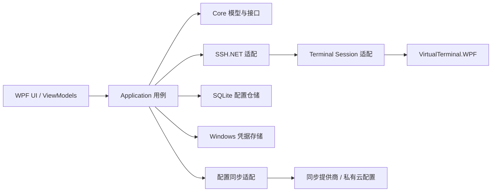

# SSH 桌面客户端正式版方案与实现规划

> 状态：正式方案与首个可运行切片；已完成 WPF 直角紧凑工作台、SQLite 主机管理、SSH 密码连接、主机指纹确认和多标签终端。基于 2026-10-15 已通过的独立终端 PoC。已确认：优先 GitHub 账号同步；V1.0 不同步 SSH 密码和私钥；采用现代极客风格。

## 1. 产品目标

为个人日常使用构建一款 Windows 桌面 SSH 工具，界面采用现代化 WPF 风格，能够管理远程主机、打开多个终端、通过 SFTP 管理文件，并登录同步账号后在设备间同步配置。

PoC 已验证 WPF 终端控件可以承载 SSH shell；中文宽字符、nano 反白、Ctrl 组合键、ANSI 粗体、回车和断线后的本地终端缓冲区保留已处理或通过人工验证。正式版应把 PoC 当作技术验证与参考实现，不把当前单窗体代码直接扩展成产品架构。

## 2. 产品边界

### V1.0 必须交付

- Windows 10/11 桌面应用，支持深色/浅色主题和合适的高 DPI 显示。
- 现代极客风格工作台：深色炭灰底色、直角分隔、紧凑的代码工作区布局和键盘优先操作；琥珀色用于焦点与主操作，青绿/青色用于连接状态和语法提示；终端保持高对比度，中文界面使用清晰的中文字体。
- 主机与分组管理：新建、编辑、复制、删除、收藏、搜索；保存主机名、端口、用户名、备注和标签。
- SSH 连接：密码认证、私钥认证、连接超时、KeepAlive、断开/重连和明确的连接状态。
- 主机身份校验：首次连接显示指纹；用户确认后持久记录；主机密钥变化时阻止静默连接并提示核验。
- 多标签终端：复制/粘贴、搜索、滚动历史、窗口尺寸同步、中文和常见 TUI 支持；断开后保留当前应用进程内的缓冲区。重连会建立新的远端 shell，不承诺恢复原进程；需要保留远端任务时使用 tmux/screen。
- SFTP 文件浏览：目录导航、上传/下载、进度、取消、覆盖确认、重命名和删除；文件操作失败需给出明确错误。
- 本地配置持久化；通过 GitHub 账号登录并在设备间同步非秘密配置，作为 V1.0 的发布项。
- 可安装/解压运行的 Windows 发布包、版本信息、诊断日志和崩溃后的可恢复体验。

### 暂缓至 V1.1 或以后

- 服务器 CPU/内存/磁盘图表、远程 Agent、团队协作或堡垒机管理平台。
- 自动命令执行、脚本编排、端口转发 UI、复杂跳板链。先保留清晰的 SSH 服务接口，确认日常需求后再实现。
- macOS/Linux 版本、应用内自动升级、同步终端输出/历史记录。

## 3. 技术方案

| 层 | 建议 | 用途与边界 |
|---|---|---|
| 桌面 UI | WPF + .NET 10 | 单平台 Windows 应用，利用现有 PoC 和 C# 技术栈。WPF 支持自定义模板、资源字典、动画和完整绘制，足以实现现代极客风格。[Microsoft WPF 文档](https://learn.microsoft.com/dotnet/desktop/wpf/overview/) |
| 现代化控件 | WPF UI（Fluent 风格） | 标题栏、导航、对话框、Snackbar、深浅主题和强调色作为基础；通过自定义 XAML 资源/模板形成品牌视觉，不直接照搬默认外观。[WPF UI 项目](https://github.com/lepoco/wpfui) |
| MVVM | CommunityToolkit.Mvvm | ViewModel、命令、属性通知；避免事件处理和业务逻辑继续集中在 MainWindow。[MVVM Toolkit 文档](https://learn.microsoft.com/dotnet/communitytoolkit/mvvm/) |
| SSH/SFTP | SSH.NET | 连接、ShellStream、SFTP、后续端口转发；产品代码通过自有接口隔离库 API。[SSH.NET API](https://sshnet.github.io/SSH.NET/api/Renci.SshNet.SshClient.html) |
| 终端 | VirtualTerminal.WPF + SSH.NET 集成层 | PoC 已实测。固定上游版本/提交，保留必要补丁和许可证；业务层依赖 `ITerminalSessionFactory` 等适配接口，降低替换成本。[VirtualTerminal](https://github.com/Rikitav/VirtualTerminal) |
| 本地数据 | SQLite（EF Core 或轻量 SQL 层） | 主机、分组、标签、窗口布局和同步元数据；不把数据库文件直接当云同步协议。首版若只做少量配置，也可用版本化 JSON，但需要迁移与原子写入。 |
| 本地机密 | Windows Credential Manager 或 DPAPI CurrentUser | 保存密码、私钥口令、OAuth/同步令牌；明文不得写入配置数据库、日志或崩溃报告。[Microsoft DPAPI 文档](https://learn.microsoft.com/dotnet/standard/security/how-to-use-data-protection) |
| 测试与发布 | xUnit 单元/集成测试；人工真实 SSH 回归；zip 发布包起步 | 先确保连接、密钥、终端、传输和同步的安全边界，再增加安装器/自动更新。 |

## 4. 建议的解决方案结构

```text
src/
  SshDesk.App/                  WPF 启动、导航、资源、主题
  SshDesk.Presentation/         Views、ViewModels、对话框
  SshDesk.Core/                 主机/凭据引用/传输任务等模型与接口
  SshDesk.Application/          Connect、ManageHosts、Transfer、Sync 用例
  SshDesk.Infrastructure.Ssh/   SSH.NET 适配、主机密钥校验、SFTP
  SshDesk.Infrastructure.Data/  SQLite 仓储、迁移、配置导入导出
  SshDesk.Infrastructure.Secrets/ Windows 凭据与加密封装
  SshDesk.Infrastructure.Sync/  同步提供商适配、冲突处理
  SshDesk.Terminal/              VirtualTerminal 封装和本地补丁
tests/
  SshDesk.Core.Tests/
  SshDesk.Application.Tests/
  SshDesk.Infrastructure.Tests/
```

依赖方向：Presentation → Application → Core；Infrastructure 实现 Core/Application 定义的接口。终端控件、SSH.NET 和同步供应商不得泄漏进 ViewModel。



## 5. 数据与安全设计

### 配置数据

- `HostProfile`：稳定 ID、名称、主机、端口、用户名、认证方式、凭据引用 ID、主机密钥策略、分组、标签、备注、创建/修改时间。
- `CredentialRef`：仅存凭据仓储中的 opaque ID 与类型，不存密码或私钥口令。
- `WorkspaceSettings`：主题、终端字号/字体、默认窗口尺寸、标签行为。
- `SyncMetadata`：提供商对象 ID、远端版本/ETag、最近成功时间、待同步状态。
- 默认不同步终端缓冲区、命令日志、SFTP 文件内容和密码。主机名/用户名/私网 IP 也可能敏感，云端同步载荷应客户端加密或由用户明确选择明文私有仓储。

### 主机身份与凭据

- 首次信任必须显示 SHA256 指纹和主机信息；记录 trust-on-first-use 状态，后续 key 变化时中止连接并要求用户重新核验。
- 本地秘密用 Windows 用户范围凭据存储。同步 access token 也存入本地秘密仓储；日志须对认证数据、私钥路径中的敏感部分和同步载荷脱敏。
- 推荐 V1.0 不同步 SSH 密码/私钥本体。多设备首次连接时各设备分别录入凭据；私钥由用户自行复制/同步到受保护位置。
- 如果“同步配置”明确包含秘密，需另做端到端加密设计（独立主密码、KDF、AEAD、恢复流程、轮换与丢失处理），不能用 DPAPI 密文直接上传，因为它绑定当前 Windows 用户/设备上下文。

### 配置同步建议

GitHub 个人账号适用于个人桌面应用：GitHub App 可以注册在个人账号下，并可启用 Device Flow；用户可以把应用安装到自己的账号，并只授权一个专用私有仓库。桌面端使用设备码流程登录，不需要应用内收集 GitHub 密码。[GitHub App Device Flow](https://docs.github.com/en/apps/creating-github-apps/authenticating-with-a-github-app/generating-a-user-access-token-for-a-github-app) · [创建 GitHub App](https://docs.github.com/en/apps/creating-github-apps/registering-a-github-app/registering-a-github-app)

推荐 V1.0 使用 **GitHub App Device Flow + 专用私有仓库**，而非 Gist：仓库仅授予必要的 Contents 读写权限和 Metadata 读取权限；同步版本化配置文件，客户端加密后再上传，并用 ETag/版本检查并发修改。GitHub 的 Secret Gist 仅是不公开列出，知道 URL 的人仍可能访问，不应当作私密配置存储。[GitHub Gist 说明](https://docs.github.com/en/get-started/writing-on-github/working-with-advanced-formatting/creating-gists)

同步内容限定为主机资料、分组、标签和界面设置。V1.0 **不上传 SSH 密码、私钥、私钥口令或任何凭据**；各设备本地分别录入。主机名、用户名和内网地址也可能敏感，配置载荷仍应在客户端加密。GitHub access/refresh token 使用 Windows Credential Manager 或 DPAPI 保护；支持退出账号并清除本地令牌。

个人自用不建议为了同步先运营一套账号服务器。先抽象 `IConfigSyncProvider`，并比较：

| 方案 | 优点 | 代价/限制 | 建议 |
|---|---|---|---|
| GitHub App Device Flow + 专用私有仓库 | 个人账号可用；无需自建服务；可限制到指定仓库和所需权限 | 依赖 GitHub；需管理 token 刷新/撤销、仓库初始化和冲突 | **V1.0 首选**；载荷客户端加密，仓库不保存 SSH 凭据 |
| OneDrive 文件 | 无需自建后端，利用已有 Microsoft 账号与同步 | 应用内“登录”体验和冲突控制较弱，需要处理文件并发修改 | 更适合简单、用户单机/少设备场景 |
| 自建 ASP.NET Core 同步 API | 账号、设备和版本冲突策略可控 | 需长期部署、备份、鉴权、密钥和服务监控 | 只有在不接受第三方提供商或要扩展多用户时采用 |

同步必须使用 schema version、原子上传/下载、ETag/版本检查、冲突副本/冲突提示和“最后成功同步时间”。不要采用静默 last-write-wins 覆盖整份配置。

## 6. 分阶段实现计划

按个人开发、AI 辅助、每周约 10–15 小时估算；范围变更和同步提供商审批不计入。目标是先得到可日用版本，再补云同步和包装。

| 阶段 | 交付内容 | 验收条件 | 估时 |
|---|---|---|---:|
| P0 产品冻结与工程基线 | 选定应用名/数据目录/最低 Windows 版本；整理 PoC 补丁、许可证、依赖版本；建立正式 solution、代码格式、CI build | 新仓库可干净 restore/build；PoC 功能从产品代码中隔离；依赖版本和第三方补丁可追溯 | 3–5 天 |
| P1 工作台骨架 | WPF UI 基础控件 + 定制极客视觉、左侧主机树、连接表单、标签工作区、设置导航；MVVM 和依赖注入 | 可创建/编辑/搜索本地主机配置；窗口布局可恢复；界面缩放与主题正常 | 1–2 周 |
| P2 SSH 安全与终端 | HostKey trust store、密码/私钥登录、KeepAlive、并发连接、错误状态、终端会话管理 | 首次指纹确认、已信任复连、密钥变化拦截；多个主机分别开标签；Ctrl/中文/TUI 回归通过；断线不误报恢复远端任务 | 2–3 周 |
| P3 本地数据与凭据 | SQLite schema/migrations、Credential Manager/DPAPI adapter、导入/导出 | 重启后主机/设置保留；秘密不出现在 DB/日志；删除主机时可选择同时删除关联凭据 | 1–2 周 |
| P4 SFTP | 远程目录列表、面包屑/路径输入、上传下载队列、进度/取消、重命名/删除/覆盖确认 | 大文件、中文路径、权限不足、断线中断均有明确行为；终端标签和文件操作互不阻塞 | 2–3 周 |
| P5 GitHub 登录与配置同步 | GitHub App Device Flow、专用私有仓库、客户端加密 payload、版本/ETag 冲突处理；不上传 SSH 密码/私钥 | 两台 Windows 机器可完成登录、首次同步、增量同步、并发冲突提示、退出账号和清理本地 token | 2–4 周 |
| P6 可交付与硬化 | 诊断日志、设置校验、取消/关闭生命周期、zip 安装包、备份与恢复说明 | 干净 Windows 环境可安装/解压启动；不会明文记日志；关闭窗口可靠断开连接；回归清单全通过 | 1–2 周 |

**计划区间：12–18 周业余时间。** 若 V1.0 先只交付本地配置并把账号同步放在 V1.1，通常可把首个日用版本压到约 8–12 周；这是更稳妥的优先级。

## 7. 质量门槛与验收

- 自动化：核心配置模型、序列化/迁移、host-key 状态、同步冲突、SFTP 队列状态机有单元测试；SSH adapter 用 mock 或可控测试服务器覆盖连接/断线/取消。
- 人工真实服务器矩阵：OpenSSH Linux 密码与密钥登录；中英文路径；nano/vim/tmux；终端 resize；SFTP 大文件和权限失败；主机密钥轮换；高延迟/断网恢复。
- 安全：绝不对所有主机自动信任；秘密不进日志/崩溃报告/普通设置文件；同步 TLS；云端配置有加密策略；第三方组件许可文件随包提供。
- 可靠性：多连接并发；连接中关闭窗口；正在传输时断线；异常退出重开；同步冲突不丢配置。
- 可用性：键盘可操作，交互控件有可访问名称，DPI 100%/150%/200% 下布局不裁切，中文界面优先覆盖核心操作。

## 8. 主要风险与应对

1. **VirtualTerminal.WPF 项目小且 PoC 已改源码。** 把终端封装在适配层；固定上游版本和本地补丁；保留许可证；每次升级跑终端回归；若关键 TUI 长期不兼容，再评估 WebView2+xterm.js，而不是自行重写 VT 引擎。
2. **主机密钥与凭据安全。** 把安全存储和 host-key 校验作为 P2/P3 的阻断验收，不留到发布前。
3. **同步冲突/机密泄露。** 同步不等同于简单复制数据库；默认不上传秘密，载荷加密并支持冲突副本。
4. **SFTP 生命周期与 UI 卡顿。** 使用异步队列、可取消任务和明确的传输状态；大文件不能占用 UI 线程。
5. **终端断线语义误解。** UI 明确区分“本地缓冲区仍保留”和“远端进程仍运行”；后者需 tmux/screen。

## 9. 已确认的产品决策与下一步

1. **账号与同步**：优先 GitHub；V1.0 采用 GitHub App Device Flow + 专用私有仓库。个人 GitHub 账号可以注册并使用 GitHub App，不需要组织账号。
2. **秘密同步**：V1.0 不同步 SSH 密码和私钥。各设备分别保存凭据；GitHub 仓库只放客户端加密后的非秘密配置。
3. **UI 风格**：使用直角边缘、紧凑页面密度和代码工作区式信息层级；采用深色炭灰底色、琥珀色焦点/主操作、青绿连接状态和高对比终端。WPF 通过自定义资源与控件模板支持此方向。
4. **开发顺序**：先完成 P0–P4 的本地可用产品，再完成 P5 同步。工程结构从一开始预留同步接口，避免同步逻辑耦合界面和数据库。

P0 已建立 solution 骨架、分层项目、主题和设计概念图。P1 已完成主机配置的分组、搜索、增删改和 SQLite 本地保存，并接通密码 SSH、HostKey TOFU（首次确认，变化时阻止静默连接）及 VirtualTerminal 多标签会话；Ctrl+A–Z 控制字符转发和窗口退出时会话清理已实现。概览页展示实时活动终端数。密码可选择保存到 Windows Credential Manager，SQLite 只保存随机凭据引用，支持忘记密码。SFTP 工作区采用本地/远程双栏目录浏览，本地盘符可切换；可多选文件或目录，通过中间按钮或跨栏拖放传输，目录传输会递归保留结构并作为单个可取消任务显示整体进度。支持逐项覆盖确认、顺序队列和取消。传输期间使用临时文件并在成功后替换目标，取消或失败时会尝试清理当前文件的临时文件；目录任务取消后已完成文件和已创建目录会保留。符号链接会显示但不会参与传输或递归。仍需用户对双栏浏览、拖放、目录递归、覆盖与取消边界进行真实服务器回归；后续实现私钥认证、KeepAlive/重连策略、GitHub Device Flow 与客户端加密同步及安装包。PoC 终端源码目前仍由正式适配项目引用，正式发布前须固定上游版本、整理补丁并携带 Apache-2.0 许可文件。

